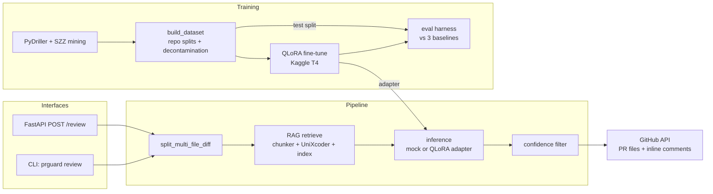

# Architecture

Key decisions:

- **Diff-level examples, not function-level.** The model sees the change the
  way a reviewer does (a diff), so train/inference conditions match.
- **Repo-level splits + near-dup decontamination** are enforced in code
  (`training/build_dataset.py`) — the standard "how do you know it generalized?"
  defense.
- **One prompt builder** (`training/prompts.py`) is shared by training, the
  fine-tuned model, and every zero-shot baseline, so the eval is fair.
- **Mock inference behind the same interface** as the real model keeps the API,
  worker, CLI, and tests runnable without torch — and makes "model or plumbing?"
  debugging trivial.
- **Tree-sitter was planned for chunking; v1 uses Python's built-in `ast`**
  (dependency-free, same precision for Python). Multi-language support is the
  stretch goal that would switch to tree-sitter.
